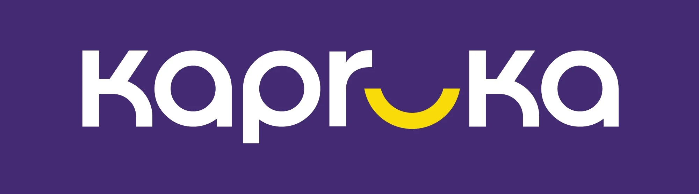

<p align="center">
  
</p>

<h1 align="center">Rukmani (රුක්මණී) — AI gift concierge for Kapruka</h1>

<p align="center">
  An entry for the <a href="https://www.kapruka.com/contactUs/agentChallenge.html">Kapruka Agent Challenge 2026</a>,
  built on the public <a href="https://mcp.kapruka.com">Kapruka MCP</a>.
</p>

---

## What it is

Rukmani is a chat shopping assistant for [Kapruka.com](https://www.kapruka.com), Sri Lanka's largest online gift shop. She helps customers go from "I'm not sure what to send" to a gift that fits:

- Talks in **Sinhala, Tamil, Singlish, Tanglish or English**, matching the customer. The whole interface switches between **English, සිංහල and தமிழ்**.
- Searches the **live Kapruka catalogue** and shows products as cards.
- Suggests **3 picks** with a reason for each: a safe pick, a "wow" pick and a budget pick.
- Checks **delivery to the customer's city and date**: fee, next available date, and a tap-to-check **date picker**. It plans around deadlines ("her birthday is Friday") and keeps cakes and flowers fresh.
- Builds a **multi-item cart**, with icing text for cakes.
- Writes the **gift card message** in the customer's language and shows a preview of the card.
- Shows a **checkout summary** with the exact total. On **Confirm**, it creates a real Kapruka order and gives a pay link, revealed with a little gift-unboxing moment.
- Offers the cheaper **economy delivery** when Kapruka allows it.
- Sends **gifts abroad** through Kapruka's overseas stores (USA, UK, Canada, Australia, UAE, and more).
- **Tracks paid orders** with a progress timeline.
- Highlights the **next Sri Lankan gifting occasion** on the welcome screen (Christmas, Avurudu, Mother's Day, and others).

Everything comes from Kapruka's real data through the Kapruka MCP server (`https://mcp.kapruka.com/mcp`). Rukmani never invents products, prices or delivery dates.

## Project structure

| Folder | What's inside | Status |
|---|---|---|
| [`backend/`](backend/) | Python API: FastAPI + LangGraph agent + Kapruka MCP client | Working |
| [`frontend/`](frontend/) | Next.js full-screen chat UI in Kapruka's colours | Working |

## How it works

```
Browser (chat UI)
   │  POST /api/chat      ← one message
   │                      → Server-Sent Events: reply text + cards (products, delivery, cart, checkout)
   │  POST /api/checkout  ← customer tapped Confirm → real order + pay link
   ▼
FastAPI
   ▼
LangGraph agent (Rukmani)  ⇄  tools: search, product details, city lookup, delivery check,
   │                               cart (add / update / remove), prepare checkout,
   │                               order tracking, overseas gift stores
   ▼
Kapruka MCP client  →  mcp.kapruka.com/mcp
```

- **The agent cannot place orders by itself.** It prepares a summary; only the customer's Confirm click calls `POST /api/checkout`, which creates the order.
- **Models are swappable profiles** (`budget`, `balanced`, `best`) in [`backend/config/models.yaml`](backend/config/models.yaml), using OpenAI and Groq.
- **Built for a public demo:** rate limits per visitor and per day, conversations saved in SQLite (they survive restarts and page refreshes), and optional Sentry error alerts.

Deploying it: see [`DEPLOYMENT.md`](DEPLOYMENT.md).

## Quick start

Details in [`backend/README.md`](backend/README.md) and [`frontend/README.md`](frontend/README.md). In short, in two terminals:

```bash
# 1. Backend → http://localhost:8000
cd backend
cp .env.example .env      # add OPENAI_API_KEY and/or GROQ_API_KEY
uv sync
uv run uvicorn kapruka_agent.api.main:app --reload --port 8000

# 2. Frontend → http://localhost:3000
cd frontend
cp .env.example .env.local
npm install
npm run dev
```

## Tech stack

- **Backend:** Python 3.11 · FastAPI · LangGraph (SQLite checkpointer) · LangChain (OpenAI, Groq) · MCP Python SDK · Pydantic · loguru · Sentry · uv · pytest · ruff · Docker
- **Frontend:** Next.js 16 · React 19 · TypeScript · Tailwind CSS 4 · Motion · lucide-react · react-markdown

## Author

**dananjayaabeytd** · dananjayaabeytd@gmail.com

---

<sub>Kapruka, the Kapruka logo and the Kapruka catalogue belong to Kapruka Holdings PLC. This is an independent challenge entry built on Kapruka's public MCP.</sub>
